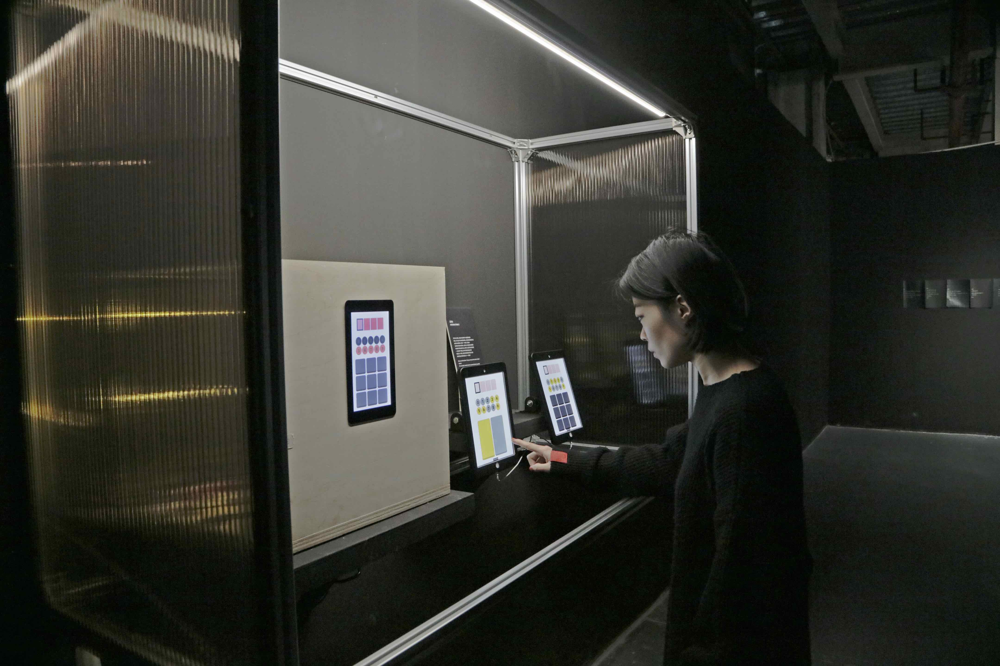
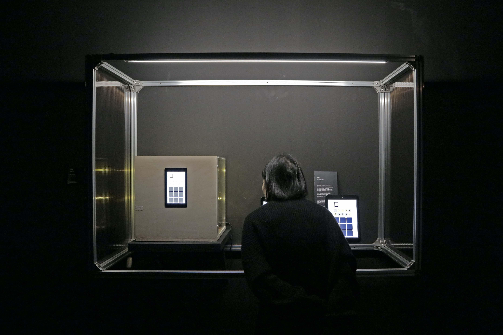
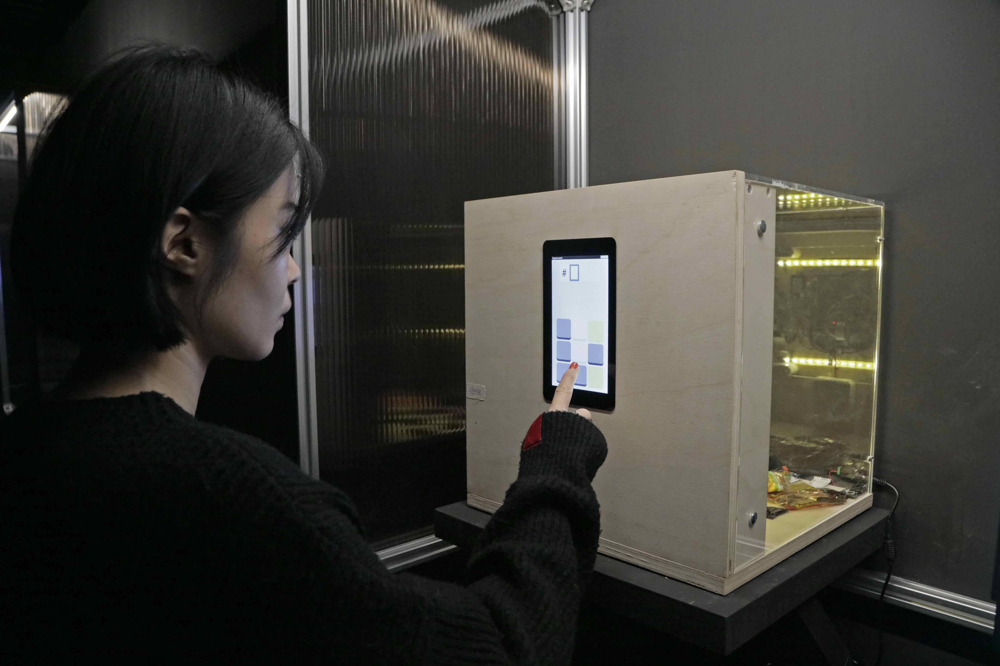
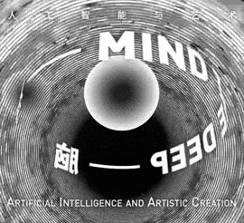
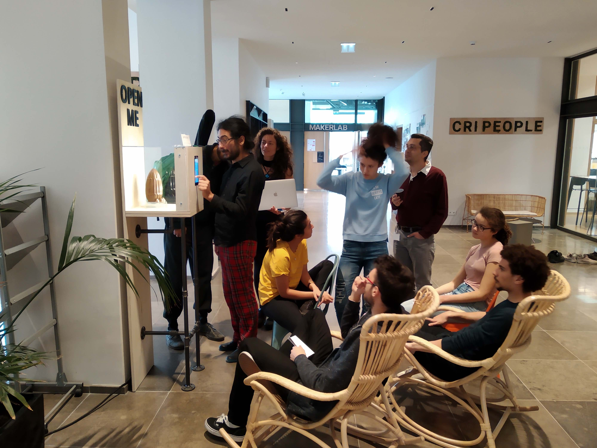
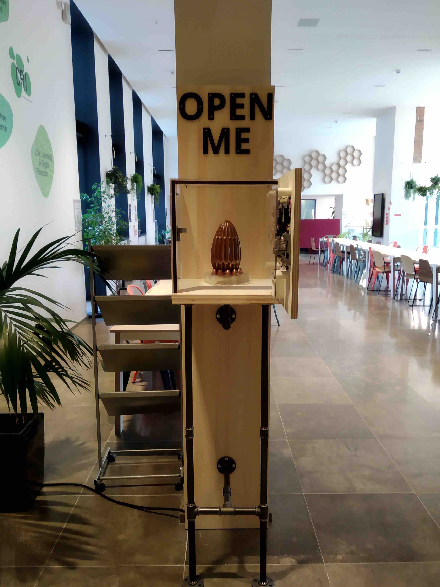
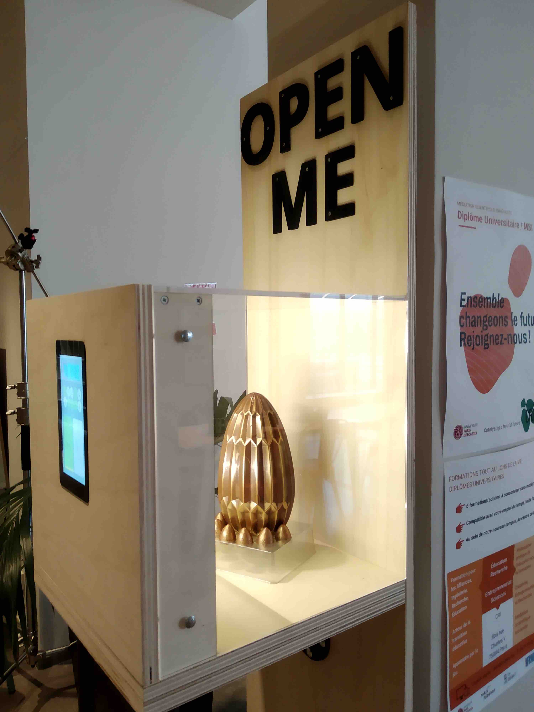

<figure>
  <iframe width="640" height="360" src="https://www.youtube.com/embed/w6hnT7ZjdKg?rel=0" frameborder="0" allowfullscreen></iframe>
  <figcaption>Transparent Vault at Nuit Blanche Paris</figcaption>
</figure>

The transparent vault was exhibited at the ["Mind The Deep"](https://www.wired.com/beyond-the-beyond/2019/10/mind-deep-artificial-intelligence-artistic-creation-shanghai/) exhibition at [MCAM](http://www.mcam.io/) the Shanghai Ming Contemporary Art Museum, upon invitation from [Baoyang Chen](https://baoyangchen.com/) and [Qiu Zhijie](https://en.wikipedia.org/wiki/Qiu_Zhijie).

It was also shown at the [Nuit Blanche 2019 in Paris](https://www.paris.fr/pages/une-nuit-blanche-en-mouvement-6889) at [CRI](https://www.cri-paris.org/en).

## @MCAM, Shanghai

<figure>
  
</figure>

<figure class="half">
  
  
</figure>

<figure class="half" style="justify-content: center;">
  
</figure>

## @CRI, Paris

<figure>
  
</figure>

<figure class="half">
  
  
</figure>

## Resources

Download the installation [guidelines](/files/Guidelines_Vault_Challenge_McaM.pdf).

## Thanks

Thanks to [Baoyang Chen](https://baoyangchen.com/) and [Qiu Zhijie](https://en.wikipedia.org/wiki/Qiu_Zhijie) for inviting me to the exhibition.
